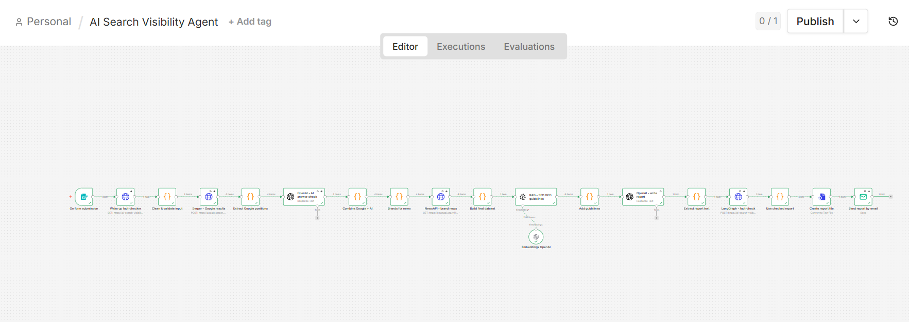
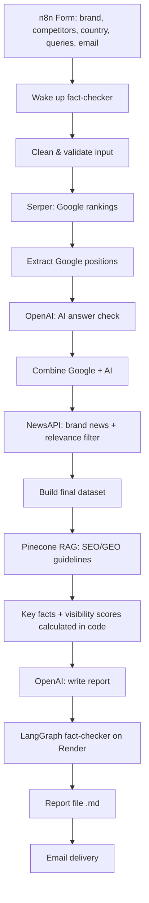
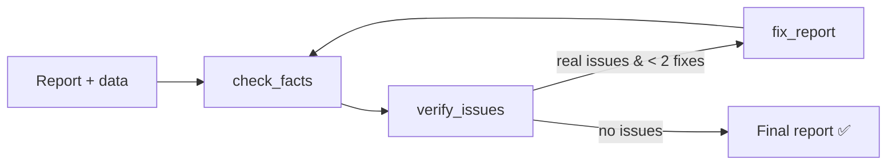

# AI Search Visibility Agent 🔍

An autonomous agent that compares a brand's visibility on **Google** and in **AI assistant answers** against its competitors, and delivers a fact-checked **SEO & GEO report** with concrete recommendations by email.

**Report user:** SEO/GEO managers and marketing leads at online brands.

**What "useful" means for them:**
- See in 1 minute where the brand is visible or missing, on Google and in AI answers
- Compare the brand directly against its competitors
- Get actions they can start this week, not generic advice

---

## Why not just ask ChatGPT?

You can ask ChatGPT "Is Zalando visible online?", but you'd get a one-off opinion. This agent gives you a **measurement**:

- **Google + AI side by side:** real Google rankings (Serper) *and* what AI assistants actually answer, compared directly. ChatGPT can't tell you your live Google position.
- **Real data, not guesses:** rankings, AI mentions and news come from live APIs, with dates and sources.
- **Facts calculated in code:** brand comparisons are computed by the workflow, so the AI only writes, not compares.
- **Fact-checked:** a LangGraph agent checks every claim against the data and fixes mistakes before delivery.
- **Grounded recommendations:** based on official Google and GEO guidelines (RAG with Pinecone), with sources.
- **Repeatable:** same queries, competitors and format every time, so visibility can be tracked over time.
- **Automated:** one form submission → multiple queries × brands × sources → finished report in your inbox in ~2–3 minutes.

---

## Sample reports

| Report | Key insight |
|---|---|
| [Zalando vs ABOUT YOU, ASOS, Shein, H&M](reports/zalando_report_2026-11-11.md) | Zalando is first among tracked brands in all AI answers, but ABOUT YOU wins Google on 3 of 4 queries. |
| [Adidas vs Nike, Puma, New Balance](reports/adidas_report_2026-11-11.md) | No brand reaches Google's top 10 for generic queries (review sites dominate), but Adidas leads AI answers. |

---

## Architecture





**LangGraph fact-checker** (`langgraph_helper/fact_checker.py`):



- **check_facts:** finds suspected errors, each must cite a calculated key fact
- **verify_issues:** a second check removes false alarms
- **fix_report:** fixes only verified errors, max 2 rounds

---

## Stack

- **Primary: n8n** (orchestration, APIs, RAG, report, delivery). See [stack_decision.md](stack_decision.md)
- **Helper: LangGraph** (fact-checker), deployed on **Render** with FastAPI
- **LLM:** OpenAI
- **Retrieval:** Pinecone (index `seo-geo-guidelines`, OpenAI `text-embedding-3-small`)

## Tools & APIs

| Tool | Purpose |
|---|---|
| Serper | Google search results (Germany) |
| OpenAI | AI answer check, report writing, fact-checking |
| NewsAPI | Recent brand news |
| Pinecone | RAG over SEO/GEO guidelines ([sources](rag_docs/sources.md)) |
| Gmail (SMTP) | Report delivery |
| Render | Hosts the LangGraph fact-checker API |

---

## Error handling

- **Input validation:** stops with a clear message if required fields are missing
- **Retries:** all API calls retry automatically
- **Continue on error:** failed APIs don't crash the run; missing data is flagged and listed in report section 7
- **Fact-checker fallback:** if the LangGraph service is unavailable, the original report is used and marked
- **Wake-up step:** wakes the Render service at the start of each run
- **Safety limits:** max 2 fix rounds, safe JSON parsing, verify step against false alarms

---

## Setup & run

**1. Clone and configure**
```bash
git clone https://github.com/barsha-mishra/ai-search-visibility-agent.git
```
Copy `.env.example` to `.env` and add your API keys.

**2. RAG (one time)**
- Create the Pinecone index: `python create_index.py`
- Import `n8n/rag_load_docs.json` into n8n and upload the PDFs listed in `rag_docs/sources.md`

**3. LangGraph fact-checker**
- Deployed on Render: `YOUR-RENDER-URL`
- Local test:
```bash
pip install -r langgraph_helper/requirements.txt
python langgraph_helper/fact_checker.py langgraph_helper/sample_data.json reports/zalando_report_2026-11-11.md
```

**4. Main workflow**
- Import `n8n/ai_search_visibility_agent.json` into n8n, add credentials (OpenAI, Serper, NewsAPI, Pinecone, SMTP)
- Click **Execute workflow**, fill in the form, and the report arrives by email in ~2–3 minutes

---

## File map

```
├── n8n/
│   ├── ai_search_visibility_agent.json   # main workflow
│   └── rag_load_docs.json                # loads PDFs into Pinecone
├── langgraph_helper/
│   ├── fact_checker.py                   # LangGraph check → verify → fix
│   ├── server.py                         # FastAPI endpoint for n8n
│   ├── requirements.txt
│   ├── sample_data.json                  # test data
│   └── test_cases/                       # deliberately wrong report + fixed result
├── reports/                              # sample reports
├── rag_docs/sources.md                   # RAG document sources
├── stack_decision.md
├── gtm_future_sprints.md
├── workflow.md
├── create_index.py
├── test_keys.py
└── .env.example
```

---

## Limitations

- AI visibility is measured via the OpenAI API, not the ChatGPT app (no live web browsing, no personalization)
- AI mention ranks (#1, #2…) are the order among **tracked brands only**
- Brand matching is name-based (e.g. "H&M" / hm.com can be missed)
- Search results change daily, so each report is a snapshot
- Render free tier sleeps when idle (handled by the wake-up step)

## Next steps

See [gtm_future_sprints.md](gtm_future_sprints.md). Planned improvements: visibility score per brand, weekly scheduled runs, results history in Google Sheets, checking more AI assistants (Claude, Perplexity, Gemini).

---

Built by **Barsha Mishra** as Project 3 of the Ironhack AI Consulting & Integration Bootcamp.
